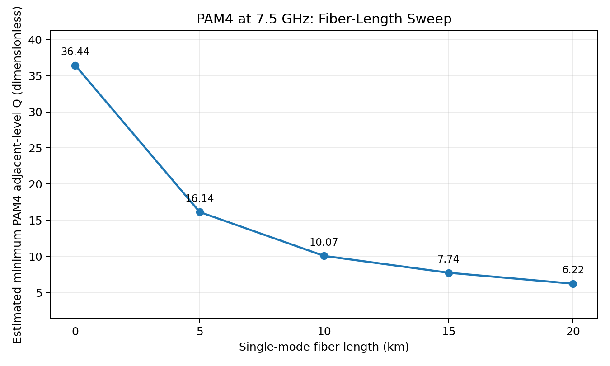
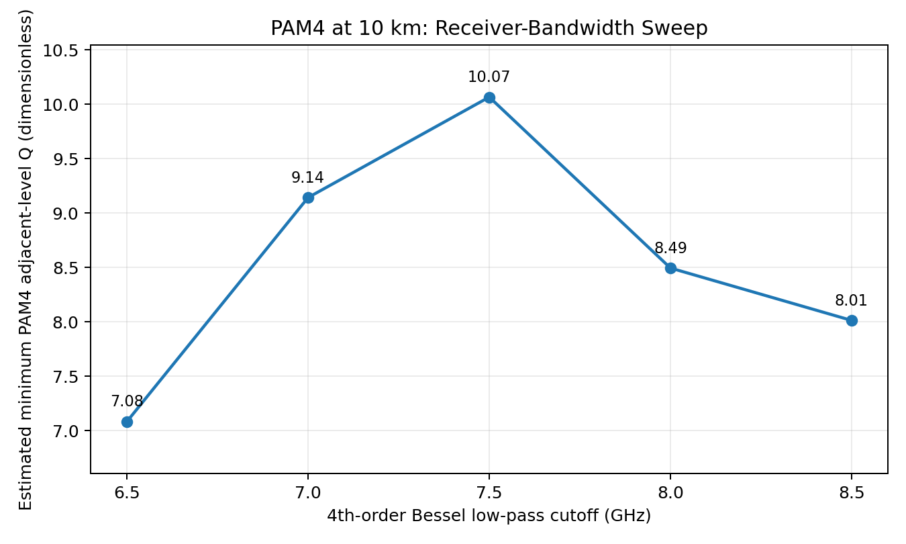

# Statistical Q-Factor Evaluation of a 25-Gb/s PAM4 Optical Link

## Overview

This repository presents a simulation-based numerical evaluation of a 25-Gb/s four-level pulse-amplitude modulation (PAM4) optical communication link implemented using **OptiSystem 23.1**.

The study investigates the impact of single-mode fiber (SMF) length and electrical receiver bandwidth on received signal quality. PAM4 eye diagrams are complemented by offline statistical Q-factor estimates calculated from transmitted and received waveform samples using Python.

The repository contains the simulation waveform exports, numerical analysis code, a Google Colab notebook, experimental results, and comparison figures.

## System Architecture

The simulated optical communication system uses an intensity-modulation/direct-detection (IM–DD) architecture.

The principal components are:

1. **BER Test Set:** Provides the test-data interface and supports comparison with the recovered binary sequence.
2. **PAM Pulse Generator:** Generates the four-level electrical PAM4 waveform.
3. **CW Laser:** Supplies the optical carrier at 1550 nm.
4. **Mach–Zehnder Modulator:** Modulates the optical carrier according to the electrical PAM4 waveform.
5. **Single-Mode Optical Fiber:** Models optical transmission with attenuation and chromatic dispersion.
6. **PIN Photodiode:** Converts the received optical signal into an electrical signal.
7. **Bessel Low-Pass Filter:** Models receiver electrical filtering.
8. **M-ary Threshold Detector:** Performs amplitude-level decisions on the received PAM4 signal.
9. **PAM Sequence Decoder:** Converts detected PAM4 symbols into a recovered binary sequence.
10. **Oscilloscopes:** Capture transmitted (TX) and received (RX) electrical waveforms.
11. **Eye Diagram Analyzer:** Visualizes the received PAM4 eye patterns.

The BER Test Set, threshold detector, and PAM decoder form the decision and test-data analysis path. The statistical Q-factor results reported in this repository are calculated separately from exported waveforms and are not measurements obtained from the BER Test Set.

## Simulation Parameters

| Parameter | Value |
|---|---|
| Simulation software | OptiSystem 23.1 |
| Modulation format | PAM4 |
| Bit rate | 25 Gb/s |
| Symbol rate | 12.5 Gbaud |
| Bits per symbol | 2 |
| Optical wavelength | 1550 nm |
| Laser output power | 0 dBm |
| Fiber attenuation | 0.2 dB/km |
| Fiber chromatic dispersion | 16.75 ps/(nm·km) |
| Dispersion slope | 0.075 ps/(nm²·km) |
| PIN photodiode responsivity | 0.8 A/W |
| Receiver filter | Fourth-order Bessel low-pass |
| Nominal filter cutoff | 7.5 GHz |
| Sequence length | 1024 bits |
| Samples per bit | 32 |
| Samples per waveform | 32,768 |

## Experimental Methodology

Two parameter sweeps were conducted while maintaining the remaining link parameters at their specified values.

### Experiment 1: Fiber-Length Variation

The optical fiber length was varied from 0 to 20 km in 5-km increments, with the receiver filter cutoff fixed at 7.5 GHz.

| Fiber length (km) | Estimated minimum statistical Q |
|---:|---:|
| 0 | 36.441916 |
| 5 | 16.138439 |
| 10 | 10.065295 |
| 15 | 7.735377 |
| 20 | 6.222313 |

The results exhibit decreasing adjacent-level statistical separation as fiber length increases.

### Experiment 2: Receiver-Bandwidth Variation

The fiber length was fixed at 10 km, while the fourth-order Bessel filter cutoff frequency was varied from 6.5 to 8.5 GHz in increments of 0.5 GHz.

| Receiver cutoff (GHz) | Estimated minimum statistical Q |
|---:|---:|
| 6.5 | 7.084370 |
| 7.0 | 9.142238 |
| 7.5 | 10.065295 |
| 8.0 | 8.494848 |
| 8.5 | 8.013745 |

The highest estimated minimum Q among the tested receiver cutoffs occurs at **7.5 GHz**, for the 10-km link.

These results describe the tested simulation conditions and do not establish a universally optimal receiver bandwidth.

## Waveform Dataset

The dataset was generated through OptiSystem simulations rather than obtained from an external dataset.

For each operating condition, the transmitted and received electrical waveforms were exported from the corresponding oscilloscopes.

Each waveform file contains two columns:

- Time, in seconds
- Signal amplitude, in the units exported by OptiSystem

The dataset consists of **nine unique simulation conditions and 18 waveform files**, with 32,768 samples per file.

The 10-km, 7.5-GHz condition is shared between the fiber-length and bandwidth experiments.

The `Optisystem/data/manifest.csv` file records simulation conditions, waveform filenames, SHA-256 checksums, and reference numerical results.

## Statistical Q-Factor Estimation

The received PAM4 signal contains four amplitude levels. The statistical separation between adjacent received levels is calculated using their conditional means and standard deviations.

For adjacent levels \(k\) and \(k+1\):

\[
Q_k = \frac{\mu_{k+1}-\mu_k}{\sigma_{k+1}+\sigma_k}
\]

where:

- \(\mu_k\) represents the mean received amplitude for PAM4 level \(k\).
- \(\sigma_k\) represents the sample standard deviation of that level.

Three adjacent-level Q estimates are obtained:

\[
Q_0,\quad Q_1,\quad Q_2
\]

The reported performance metric is:

\[
Q_{\min}=\min(Q_0,Q_1,Q_2)
\]

### Computational Procedure

1. Import the transmitted and received waveform files using Python and NumPy.
2. Identify transmitted PAM4 symbols from the TX waveform.
3. Exclude eight symbols at each end of the simulation record.
4. Select the receiver sampling offset by maximizing the minimum adjacent-level Q on the first half of the retained symbols.
5. Group the corresponding received samples into four PAM4 levels.
6. Calculate conditional means and sample standard deviations.
7. Compute the three adjacent-level statistical Q estimates and report their minimum.
8. Calculate a second-half Q estimate as an additional diagnostic.
9. Generate numerical CSV results and graphical comparisons using Matplotlib.

A total of 496 PAM4 symbols are retained from each 512-symbol record.

The receiver sampling offset is selected from 128 candidate sample positions. Full-record Q estimates use all retained symbols, while second-half estimates provide an additional consistency check.

## Python Implementation

The computational analysis uses:

- **Python:** Numerical processing and experiment automation
- **NumPy:** Waveform loading, array operations, means, and standard deviations
- **Matplotlib:** Numerical result visualization
- **CSV and hashlib:** Result storage and waveform integrity verification

The main implementation files are:

| File | Purpose |
|---|---|
| `Optisystem/src/pam4_q.py` | Statistical Q-factor calculation |
| `Optisystem/scripts/reproduce_all.py` | Batch analysis and result verification |
| `Optisystem/notebooks/PAM4_Q_Analysis_Colab_FIXED.ipynb` | Interactive reproducible analysis |
| `Optisystem/data/manifest.csv` | Experiment metadata and checksums |

No machine-learning model is trained or used in the statistical Q-factor computation.

## Reproduce Results in Google Colab

[**Open the Python analysis notebook in Google Colab**](https://colab.research.google.com/github/SHAHRIAR-HOSSAIN-RIMON/OptiSystem_lab_final/blob/main/Optisystem/notebooks/PAM4_Q_Analysis_Colab_FIXED.ipynb)

To execute the analysis:

1. Open the notebook in Google Colab.
2. Select **Runtime → Run all**.
3. The notebook retrieves the repository and locates the experimental dataset.
4. Waveform file checksums are verified against the experiment manifest.
5. The nine simulation conditions are processed.
6. Statistical Q estimates, summary tables, and comparison graphs are generated.

The notebook is designed to reuse an existing repository checkout during repeated execution.

## Reproduce Results Locally

Requirements: Python 3.10 or newer, NumPy, and Matplotlib.

Clone the repository:

`git clone https://github.com/SHAHRIAR-HOSSAIN-RIMON/OptiSystem_lab_final.git`

Enter the analysis directory:

`cd OptiSystem_lab_final/Optisystem`

Install dependencies:

`python -m pip install -r requirements.txt`

Execute all experiments:

`python scripts/reproduce_all.py`

The script checks the waveform SHA-256 hashes and compares recomputed Q values against the archived values within a numerical tolerance of \(2\times10^{-5}\).

## Repository Structure

- `README.md` — Project documentation
- `Optisystem/data/manifest.csv` — Experiment metadata and checksums
- `Optisystem/data/waveforms/` — Original TX/RX waveform files
- `Optisystem/src/pam4_q.py` — Statistical signal-analysis implementation
- `Optisystem/scripts/reproduce_all.py` — Automated experiment reconstruction
- `Optisystem/notebooks/` — Google Colab notebook
- `Optisystem/results/summary/` — Numerical results
- `Optisystem/results/figures/` — Comparison figures
- `Optisystem/results/per_run/` — Individual level statistics and figures
- `Optisystem/requirements.txt` — Python dependencies

## Scope and Limitations

The reported Q values are **offline, waveform-derived adjacent-level statistical separation estimates**. They are not direct OptiSystem Q-factor measurements or experimentally validated bit-error-rate estimates.

Each condition uses a finite 1024-bit simulation record. Some experiments use different transmitted symbol sequences, and repeated-run confidence intervals were not established.

The results therefore support a descriptive comparison across the evaluated simulation conditions rather than a general statistical characterization of optical-link reliability.

The repository includes exported simulation data and Python analysis software. It does not contain an editable OptiSystem circuit file, so full reproduction of the original optical simulation requires the corresponding OptiSystem model and settings.

## Research Context

This analysis accompanies an IEEE conference-style manuscript investigating the effects of fiber length and receiver bandwidth on a simulated 25-Gb/s PAM4 optical link.

The numerical workflow provides traceable, reproducible statistical-Q calculations from the archived OptiSystem waveform exports.
